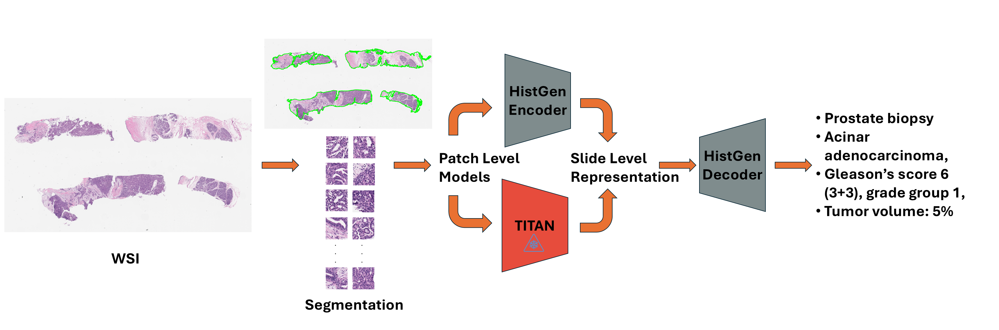
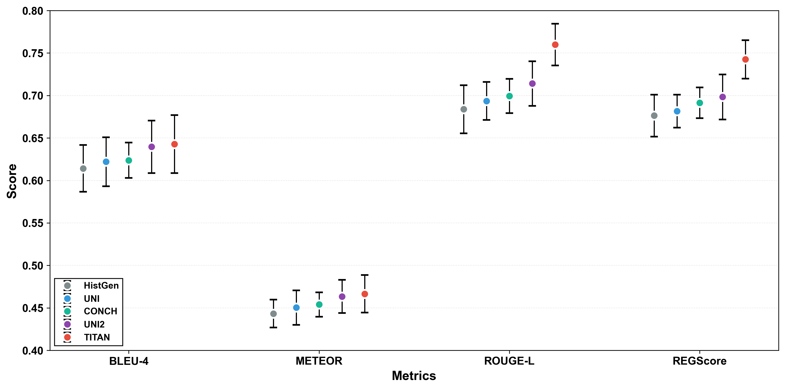
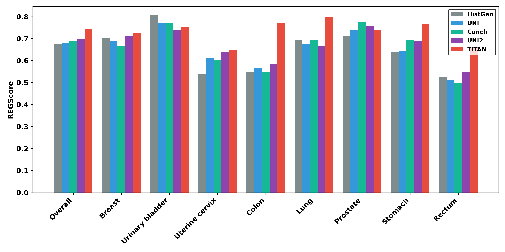
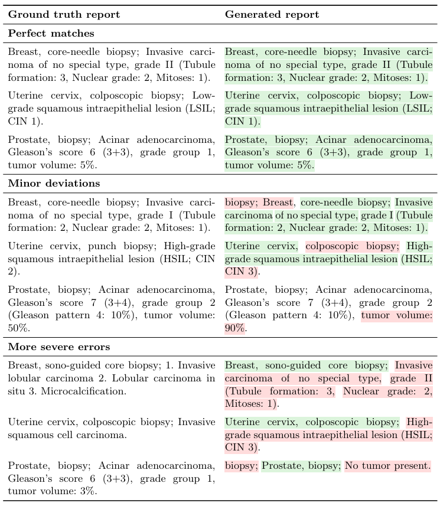

# Slide-Level vs. Patch-Level Encoding for Automated Pathology Report Generation: A Systematic Evaluation

## Aim of the Project
This project presents a systematic evaluation of whether automated report generation benefits more from **learned patch-level aggregation** using enhanced patch-level foundation models, or from **frozen slide-level encoding**, on the REG2025 dataset. We use [HistGen](https://github.com/dddavid4real/HistGen/tree/main) as the baseline — a multiple instance learning (MIL) framework with hierarchical feature aggregation for report generation. We replace its feature extractor with modern patch-level foundation models (UNI, UNI2, CONCH). We then replace HistGen's encoder and cross-modal context module entirely with TITAN, a frozen pretrained slide-level foundation model, training only the decoder. For a detailed flowchart, see [this](assets/detailed_workflow.png).

## Key Contributions
This project systematically compares patch-level and slide-level encoding paradigms for diagnostic report generation in computational pathology. We evaluate five configurations on the REG2025 dataset (8,352 WSI-report pairs spanning seven organ types with standardized CAP protocol reports), using HistGen as the baseline framework.

1. **Slide-level encoding wins**: We show that slide-level encoding with TITAN significantly outperforms the baseline HistGen pipeline (ViT-L extractor) and HistGen-based pipelines using UNI, CONCH, and UNI2 as feature extractors on ROUGE-L and REGScore.
2. **The gain isn't just CONCH features**: TITAN’s advantage is not explained by its CONCH-derived patch features alone, and is consistent with a benefit of frozen slide-level encoding.
3. **Scale helps at the patch level too**:  UNI2, which increases both model capacity and pretraining data over UNI, gave the largest gains among the patch-level encoders, suggesting that scaling encoder strength and pretraining corpus size can be beneficial.


## Results



*Mean performance of all models across four evaluation metrics. Each point shows the average BLEU-4, METEOR, ROUGE-L, and REG Score on the test set for HistGen (ViT-L), UNI, CONCH, UNI2, and TITAN, with vertical error bars indicating one standard deviation across five runs.*

## Statistical Analysis & Benchmarking

All models were evaluated over 5 random seeds (reported as Mean ± SD). 95% Confidence Intervals (CI) for differences in **REGScore** were derived using a paired bootstrap over the 1,002 test cases with 10,000 resamples. Asterisks (\*) indicate statistically significant improvements adjusted for multiple testing using the Holm procedure ($p_{\text{adj}} < 0.05$). METEOR was not formally tested for significance. Bold values indicate the best-performing model.

---

### Table 1: Enhanced Encoders vs. HistGen Baseline

*Differences are computed as **Model − HistGen**. Positive CI values indicate that the model outperforms the HistGen baseline.*

| Model | BLEU-4 ↑ (Mean±SD) | METEOR ↑ (Mean±SD) | ROUGE-L ↑ (Mean±SD) | REGScore ↑ (Mean±SD) | 95% CI (REGScore diff.) |
| :--- | :---: | :---: | :---: | :---: | :---: |
| **HistGen** | 0.614 ± 0.028 | 0.443 ± 0.016 | 0.684 ± 0.028 | 0.676 ± 0.025 | — |
| **UNI** | 0.622 ± 0.029 | 0.450 ± 0.020 | 0.694 ± 0.022 | 0.682 ± 0.019 | [-0.0032, 0.0138] |
| **CONCH** | 0.624 ± 0.021 | 0.454 ± 0.014 | 0.699 ± 0.020\* | 0.691 ± 0.018\* | [0.0056, 0.0247] |
| **UNI2** | 0.640 ± 0.031\* | 0.464 ± 0.020 | 0.714 ± 0.026\* | 0.698 ± 0.027\* | [0.0131, 0.0314] |
| **TITAN** | **0.643 ± 0.034**\* | **0.467 ± 0.022** | **0.760 ± 0.025**\* | **0.742 ± 0.023**\* | **[0.0547, 0.0782]** |

> **Key Findings:**
> - **UNI** showed no statistically significant improvements over HistGen across tested metrics (all $p_{\text{adj}} > 0.26$).
> - **CONCH** significantly improved domain-specific REGScore ($p_{\text{adj}} = 0.012$) and text-overlap ROUGE-L ($p_{\text{adj}} = 0.040$).
> - **UNI2** and **TITAN** significantly improved all three evaluated metrics ($p_{\text{adj}} < 0.01$).
> - **TITAN** achieved the largest overall gains over baseline (REGScore $+0.066$, ROUGE-L $+0.076$).

---

### Table 2: Patch-Level Models vs. TITAN

*Differences are computed as **TITAN − Model**. Positive CI values indicate that the corresponding patch-level model underperforms TITAN.*

| Model | BLEU-4 ↑ (Mean±SD) | METEOR ↑ (Mean±SD) | ROUGE-L ↑ (Mean±SD) | REGScore ↑ (Mean±SD) | 95% CI (REGScore diff.) |
| :--- | :---: | :---: | :---: | :---: | :---: |
| **TITAN** | 0.643 ± 0.034 | 0.467 ± 0.022 | 0.760 ± 0.025 | 0.742 ± 0.023 | — |
| **UNI** | 0.622 ± 0.029\* | 0.450 ± 0.020 | 0.694 ± 0.022\* | 0.682 ± 0.019\* | [0.0498, 0.0723] |
| **CONCH** | 0.624 ± 0.021\* | 0.454 ± 0.014 | 0.699 ± 0.020\* | 0.691 ± 0.018\* | [0.0405, 0.0618] |
| **UNI2** | 0.640 ± 0.031 | 0.464 ± 0.020 | 0.714 ± 0.026\* | 0.698 ± 0.027\* | [0.0336, 0.0548] |

> **Key Findings:**
> - **TITAN** demonstrated the strongest performance across all metrics, significantly outperforming UNI, CONCH, and UNI2 on ROUGE-L and REGScore (all $p_{\text{adj}} < 0.001$, yielding REGScore improvements of $+0.061$, $+0.051$, and $+0.044$ respectively).
> - On BLEU-4, TITAN significantly outperformed UNI and CONCH ($p_{\text{adj}} = 0.044$), while the difference against UNI2 was not statistically significant ($p_{\text{adj}} = 0.71$).
> - Because TITAN constructs slide-level embeddings directly on top of CONCH patch representations, its clear statistical gain over CONCH demonstrates the explicit benefit of frozen slide-level aggregation compared to patch-level sequence modeling.

### Anatomical-Level Performance

*Anatomical-level REG Score for all models. Bars show mean REG Score on the test set for HistGen (ViT-L), UNI, CONCH, UNI2, and TITAN, computed overall and separately for each organ. TITAN consistently outperforms other models on the more difficult organs (colon, rectum, lung, stomach), while all models perform similarly on organs with larger, longer-report datasets (breast, prostate).*

### Qualitative Examples

<p align="center">
  
</p>

*Qualitative examples of pathology reports generated by TITAN compared to ground truth. Green highlights indicate text that matches ground truth exactly, while red highlights indicate incorrect, missing, or misordered content.*


## Usage
1. Preprocessing
   
   For segnmentation use [CLAM patching script](/HistGen/CLAM/patching_scripts/tcga-wsi-report.sh) using the [clam](/Conda%20Environments/clam.yml) environment.
   
   For feature extraction using HistGen feature extractor, UNI or UNI2 use the respective [scripts](/HistGen/CLAM/extract_scripts) using [clam](/Conda%20Environments/clam.yml) environment. For CONCH use this [script](/HistGen4TITAN/CONCH%20CLAM/extract_features_calling_script.sh) and post process the features with the postprocessing [script](/HistGen4TITAN/CONCH%20CLAM/PostProcess%20CONCH%20Features/postprocess_featues.ipynb) using [clam_conch](/Conda%20Environments/clam_conch.yml) environment.
   
   To create slide embeddings ftom TITAN use the [TITAN slide embeddings script](/HistGen4TITAN/extractSlideEmbeddings.py) using [histgen_titan](/Conda%20Environments/histgen_titan.yml) environment.

2. Training
   
   To train Histgen baseline and other patch level encoder variants (UNI, UNI2 and CONCH) use the [HistGen training](/HistGen/train_wsi_reportseed4x.sh), [UNI training](/HistGen/train_wsi_report_uni1_seed4x.sh), [UNI2 training](/HistGen/train_wsi_report_uni2_seed4x.sh) and [CONCH training](HistGen/train_wsi_report_conch_histgen_seed42.sh) scripts respectively using the [histgen](/Conda%20Environments/histgen.yml) environment.

   To train TITAN, use [TITAN training](/HistGen4TITAN/train_wsi_report_TITAN.sh) script using [histgen_titan](/Conda%20Environments/histgen_titan.yml) environment.

4. Inference

   For BLUE, METEOR, ROUGE-L, use the [HistGen testing](/HistGen/test_wsi_report_seed4x.sh), [UNI testing](/HistGen/test_wsi_report_UNI1_seed4x.sh), [UNI2 testing](/HistGen/test_wsi_report_UNI2_1_seed4x.sh) and [CONCH testing](/HistGen/test_wsi_report_conch_seed4x.sh) scripts respectively with [histgen](/Conda%20Environments/histgen.yml) environment. For TITAN use [TITAN testing](/HistGen4TITAN/test_wsi_report_5_seed4x.sh) script with [histgen_titan](/Conda%20Environments/histgen_titan.yml) environment.

   For REGScore use the script [HistGen testing](/Other%20Activities/REG2025%20Inference/reg_evaluator.py) with [reg2025-eval](/Conda%20Environments/reg2025-eval.yml) environmet for all the models.

Sample job scripts are present in [Scripts](/job_scripts/)

All the results can be found in [Results](/results/)

## Acknowledgments and Licensing
This codebase builds on HistGen (Guo et al., MICCAI 2024), used under the Apache License 2.0. Portions of the original HistGen code have been modified and extended to integrate additional patch- and slide-level encoders (UNI, UNI2, CONCH, TITAN) and to adapt the training and evaluation pipeline for this study. A copy of the Apache License 2.0 is included in this repository (see LICENSE).

If you use this repository, please also consider citing the original HistGen paper:
```bibtex
@inproceedings{guo2024histgen,
  title={Histgen: Histopathology report generation via local-global feature encoding and cross-modal context interaction},
  author={Guo, Zhengrui and Ma, Jiabo and Xu, Yingxue and Wang, Yihui and Wang, Liansheng and Chen, Hao},
  booktitle={International Conference on Medical Image Computing and Computer-Assisted Intervention},
  pages={189--199},
  year={2024},
  organization={Springer}
}
```
This repository also integrates the following pretrained encoders, each subject to its own license and access conditions on the Hugging Face Hub:

- [HistGen](https://huggingface.co/datasets/david4real/HistGen)
  
– [UNI](https://huggingface.co/MahmoodLab/UNI)

– [UNI2](https://huggingface.co/MahmoodLab/UNI2-h)

– [CONCH](https://huggingface.co/MahmoodLab/CONCH)

– [TITAN](https://huggingface.co/MahmoodLab/TITAN)
